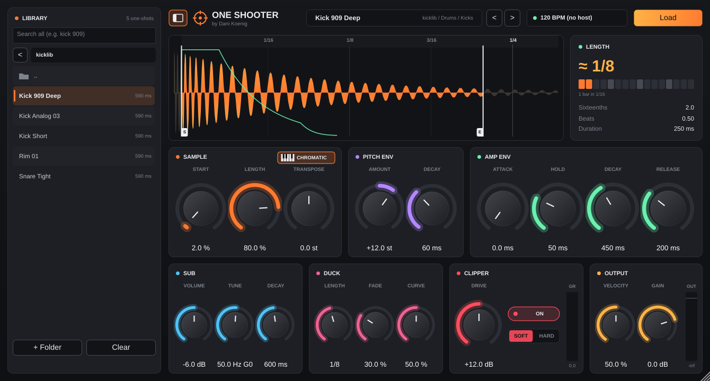

# One Shooter

A one-shot sample player (VST3 and Audio Unit) for macOS on Apple Silicon, inspired by Ableton's Drum Sampler. Built for kicks, works with any one-shot.

by Dani Koenig



## Features

- **Sample:** load by drag & drop or the Load button (WAV, AIFF, FLAC, MP3, OGG, M4A, CAF). Waveform with draggable start and end markers (double-click = whole sample).
- **Note-value grid:** the waveform is labelled from the start marker in note values (1/16, 1/8, 3/16, 1/4 ...) at your DAW's tempo. Transpose and pitch envelope are taken into account.
- **Length card:** shows the nearest note value, a one-bar 16th grid, beats and milliseconds.
- **Root note:** detected automatically when you load a sample (falls back to the key in the file name, e.g. `Chord_Hit_Dm`). Click the ROOT pill in the header to choose it, double-click to type it (e.g. `F#2`).
- **Chromatic mode** (keyboard button): the pitch follows the MIDI key, the root key plays the original pitch. Off: every key plays the sample at the same pitch (drum mode).
- **Mono / Poly:** Mono = a new hit chokes the previous one (kicks, 808s). Poly = notes ring out together (chords).
- **Pitch envelope:** amount (±48 semitones) and decay. Applies to the sample and the sub.
- **Amp envelope:** attack, hold, decay, release (release Off = one-shot).
- **Sub oscillator:** volume, tune (Hz with note name), decay.
- **Gate:** cuts every hit to a length synced to your DAW tempo (Off, 1/32 to 1 bar), with fade and curve controls.
- **Tone:** tilt (darker/brighter), Low Cut and High Cut.
- **Clipper** (KNOCK style): drive, soft/hard, 4x oversampling, gain reduction meter, **Auto Gain** (loudness matched, so you hear the saturation, not just more level).
- **Limiter** on the output (ceiling -1 dB) with gain reduction meter.
- **Library:**
  - Drop a folder onto the plugin to find all one-shots inside it, including subfolders.
  - Each imported folder shows all its samples as one flat list.
  - Search across everything, audition by click or arrow keys, prev/next buttons in the header.
  - Show or hide the library with the button next to the logo.
  - Your files are never moved or copied. The index is stored in `~/Library/Application Support/One Shooter/library.json`.
- All parameters can be automated. The sample path is saved with your project.

## Download

Get the latest version from the [Releases page](https://github.com/danikoenig/OneShooter/releases):

- **OneShooter-Installer.pkg** – easiest, no Terminal needed
- **OneShooter-VST3-macOS-arm64.zip** – VST3 and AU plugin plus the install guide, for manual installation

## Installation

Step-by-step guide (English and German): [INSTALL.txt](INSTALL.txt)

**Installer:** double-click `OneShooter-Installer.pkg`. Because the plugin is not notarized by Apple, macOS blocks it the first time: open **System Settings → Privacy & Security**, click **Open Anyway**, then run the installer. It installs the VST3 to `/Library/Audio/Plug-Ins/VST3` and the Audio Unit to `/Library/Audio/Plug-Ins/Components`.

**Manual (Terminal):** unzip in your Downloads folder, then:

```
mkdir -p ~/Library/Audio/Plug-Ins/VST3 ~/Library/Audio/Plug-Ins/Components
cp -R "$(find ~/Downloads -maxdepth 3 -name "One Shooter.vst3" -print -quit)" ~/Library/Audio/Plug-Ins/VST3/
cp -R "$(find ~/Downloads -maxdepth 3 -name "One Shooter.component" -print -quit)" ~/Library/Audio/Plug-Ins/Components/
xattr -dr com.apple.quarantine ~/Library/Audio/Plug-Ins/VST3/"One Shooter.vst3" ~/Library/Audio/Plug-Ins/Components/"One Shooter.component"
```

Then restart your DAW and rescan plugins.

**Requirements:** Apple Silicon Mac (M1 or newer), macOS 11 or newer, a DAW with VST3 (Bitwig, Ableton Live, Cubase, Studio One, Reaper ...) or Audio Unit support (Logic Pro, GarageBand).

## Building

Every push to `main` builds the plugin automatically with GitHub Actions on an Apple Silicon runner.

To build locally, you need the Xcode Command Line Tools and CMake (`brew install cmake`):

```
cmake -B build -DCMAKE_BUILD_TYPE=Release -DCMAKE_OSX_ARCHITECTURES=arm64
cmake --build build --target OneShooter_VST3 OneShooter_AU -j 8
```

Output: `build/OneShooter_artefacts/Release/VST3/One Shooter.vst3` and `build/OneShooter_artefacts/Release/AU/One Shooter.component`

## Notes

- Samples are stored by file path. If you move a file, load it again.
- The decay envelope ends at -60 dB.
- Built with [JUCE](https://juce.com) 8.0.4, which is downloaded automatically during the build.
